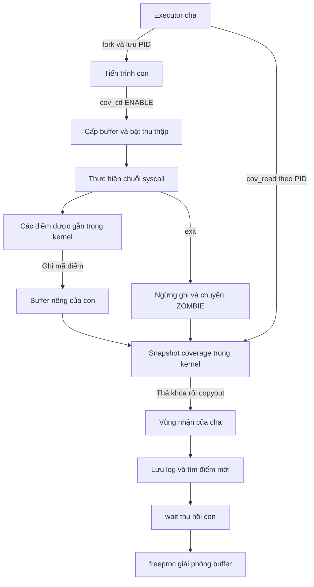
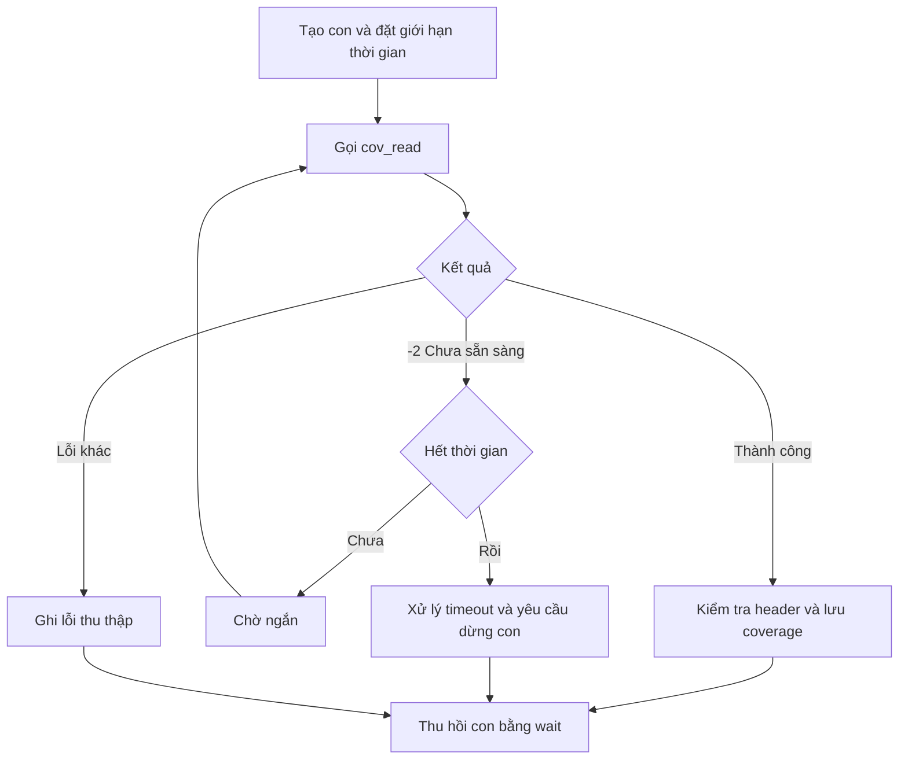

# Kernel Coverage Data Flow

## 1. Phạm vi

Sơ đồ mô tả thiết kế dự kiến cho prototype coverage.
Chưa phải chức năng đã triển khai.

Mỗi tiến trình được bật coverage có buffer riêng.
Executor đọc coverage của con trực tiếp khi con là ZOMBIE,
trước khi gọi wait để thu hồi con.

## 2. Luồng thu thập và trả dữ liệu

## 3. Luồng điều khiển của executor

## 4. Dữ liệu giữa các thành phần

| Nguồn | Đích | Dữ liệu |
|---|---|---|
| Executor | Tiến trình con | Testcase, seed và cấu hình chạy |
| Tiến trình con | API điều khiển | RESET, ENABLE hoặc DISABLE |
| Điểm trong kernel | Buffer coverage | Mã điểm thực thi |
| Executor | API đọc | PID con, địa chỉ và kích thước vùng nhận |
| API đọc | User space của executor | version, count, capacity, overflow và mã điểm |
| Executor | Log hoặc corpus | Testcase ID, seed, coverage và trạng thái chạy |

## 5. Quy tắc xử lý

- Executor không gọi wait trước khi đọc xong hoặc quyết định
  bỏ kết quả coverage.
- Không gọi copyout khi giữ spinlock.
- Nếu buffer đầy, dừng ghi thêm và đặt overflow.
- Nếu API đọc trả lỗi, không sử dụng dữ liệu nhận được.
- Nếu con chưa có buffer, ghi nhận thiếu dữ liệu; không coi
  đây là testcase có coverage rỗng hợp lệ.
- Với lỗi thu thập khi con còn chạy, executor phải bảo đảm
  con kết thúc hoặc yêu cầu dừng trước khi thu hồi.
- Khi timeout, phải có giới hạn chờ và cơ chế giám sát;
  kill không bảo đảm xử lý được một kernel đã treo.
- Khi kernel panic hoặc treo, bộ giám sát ngoài QEMU lưu
  testcase và log; không bảo đảm lấy được coverage.
- Coverage của tiến trình cháu chưa được tổng hợp.

## 6. Nội dung cần nhóm xác nhận

- Executor hỗ trợ trình tự đọc coverage trước wait.
- API và định dạng dữ liệu khớp coverage-design.md.
- Một con testcase được thực thi tại một thời điểm cho mỗi executor.
- Thống nhất timeout, kill, thu hồi tiến trình và reset QEMU.
- Thống nhất commit kernel và phiên bản bảng mã điểm.
