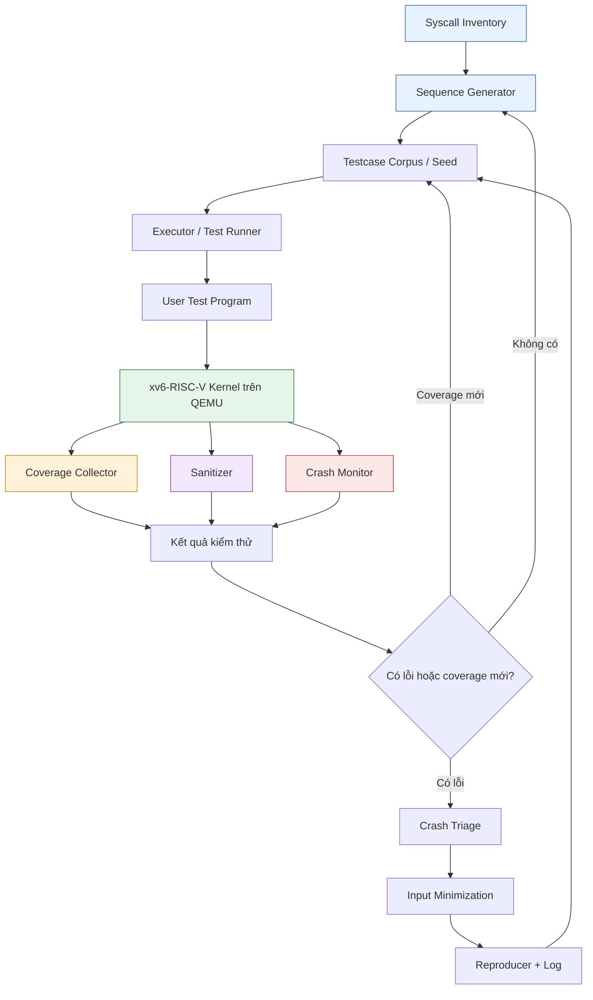

# System Call Fuzzer Workflow

## 1. Sơ đồ luồng hoạt động toàn hệ thống

## 2. Mô tả các module

1. **Syscall Inventory:** lấy danh sách system call từ source xv6.
2. **Sequence Generator:** sinh chuỗi system call và tham số.
3. **Testcase Corpus:** lưu seed và các testcase có giá trị.
4. **Executor:** chạy chương trình kiểm thử trên xv6-RISC-V bằng QEMU.
5. **Coverage Collector:** ghi nhận đường thực thi đã đi qua.
6. **Sanitizer:** hỗ trợ phát hiện các lỗi bộ nhớ, bao gồm use-after-free khi có cơ chế kiểm tra phù hợp.
7. **Crash Monitor:** phát hiện panic, crash hoặc kernel bị treo.
8. **Crash Triage và Input Minimization:** phân loại lỗi, rút gọn testcase gây lỗi.
9. **Reproducer:** lưu testcase tối thiểu và log để nhóm tái hiện, phân tích.

## 3. Tiêu chí bàn giao

- Chạy lại được một chuỗi system call đã lưu.
- Phát hiện được kernel panic hoặc timeout theo cơ chế giám sát đã triển khai.
- Lưu được testcase và log khi phát hiện lỗi.
- Có thể tái hiện lỗi và đánh giá coverage.
- Có tài liệu hướng dẫn chạy thử và đánh giá kết quả.

> Sơ đồ mô tả kiến trúc mục tiêu. Các chức năng cần được kiểm thử thực tế trước khi xác nhận đã triển khai hoàn chỉnh.

